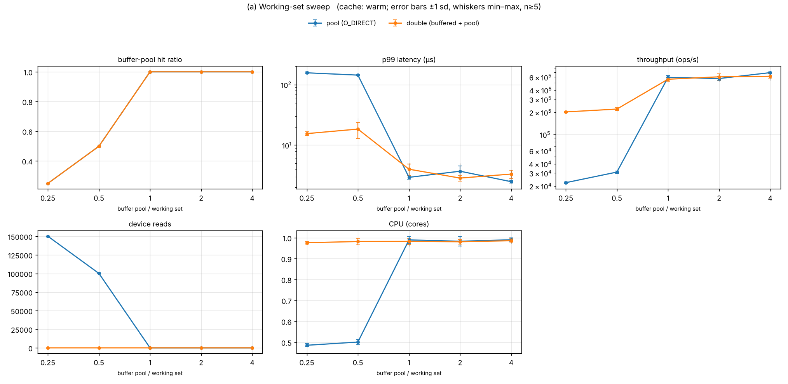
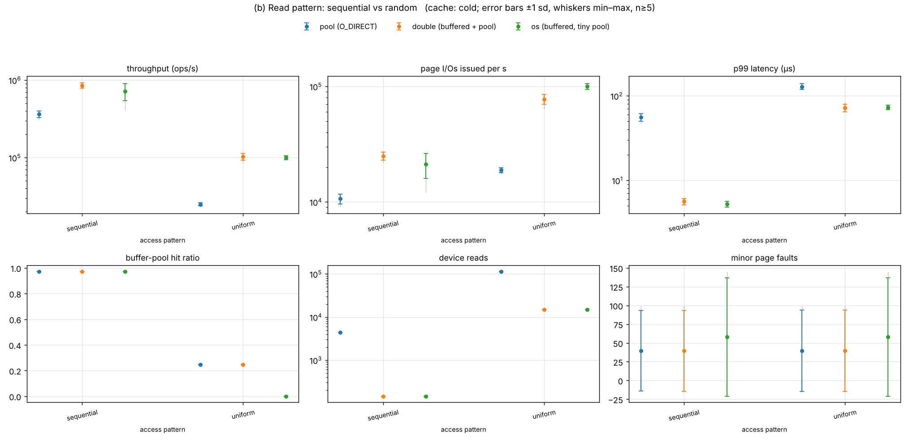
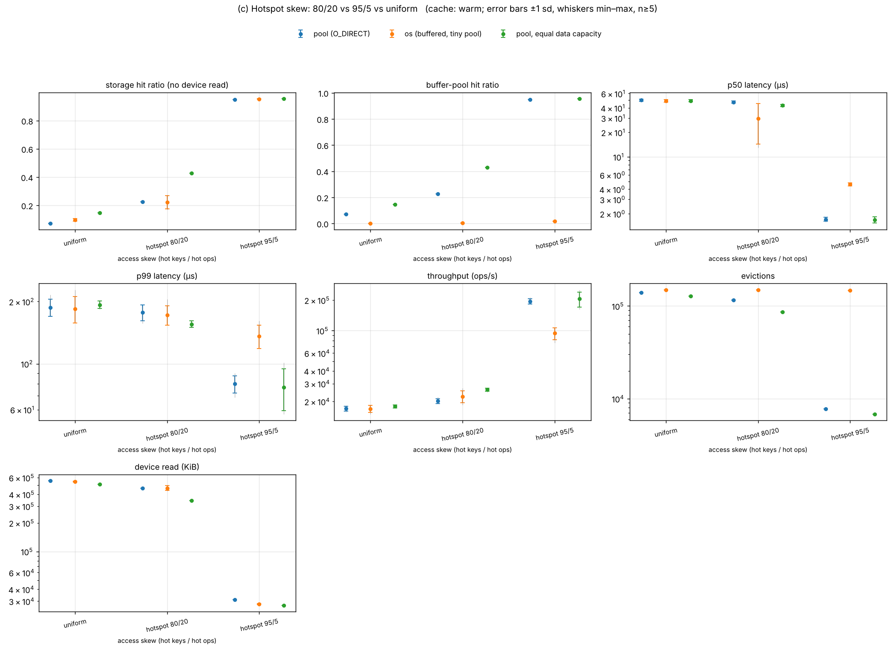
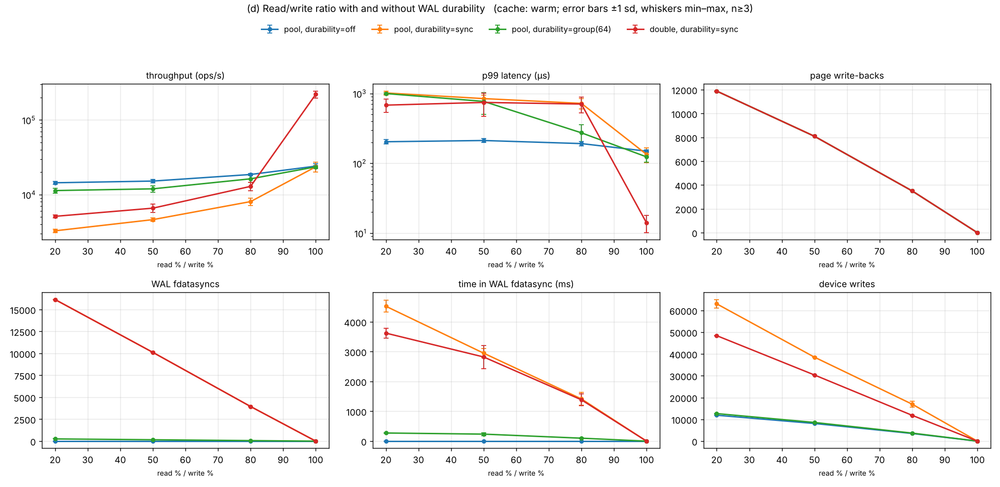
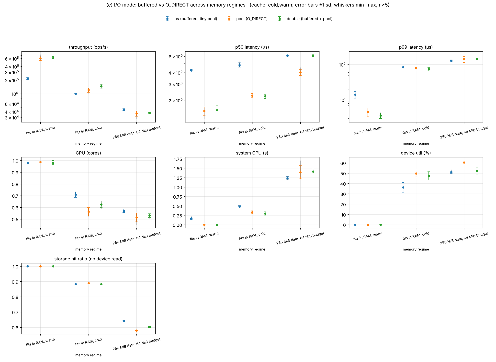
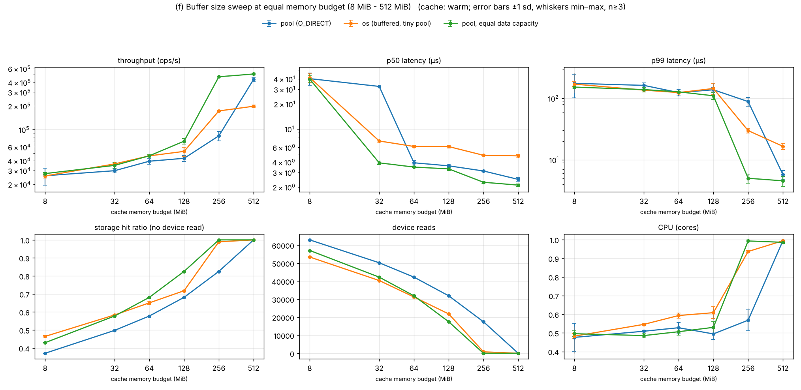
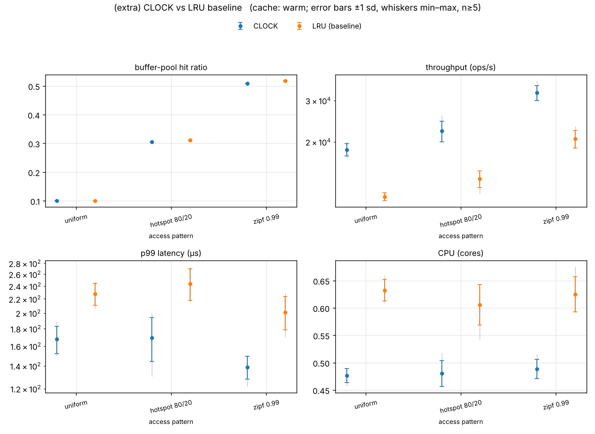

# BufferScope — Comparative Experiments (Phase 8)

All numbers in this document were measured by `scripts/run_experiments.py` (matrix in
`configs/experiments.toml`). They come from the raw CSVs in `results/raw/` and were
plotted by `scripts/plot.py`. Tables are copied from `results/summary/*.md`, which
`plot.py` generates from the same aggregates as the plots, and `scripts/check_results.py`
verifies that plots and CSVs agree. No number is estimated or typed in by hand.

## Methodology

**Environment.** 2-vCPU Intel Xeon @ 2.1 GHz cloud VM, 7 GiB RAM, Linux 6.18,
ext4 on a virtio block device (`/dev/vda`, 512 B logical / 4 KiB physical sectors).
The data directory is on that ext4 filesystem (not tmpfs). Snapshot:
`results/raw/environment.txt`. Device baseline measured by the runner: ~15–18 k random
4 KiB reads/s at queue depth 1, `r_await` ≈ 0.04 ms. The disk is virtualised, so absolute
latencies reflect this VM, not a bare-metal NVMe.

**Protocol (every configuration).**
1. Fresh database file and WAL.
2. **Load** (untimed): every key inserted once in key order (11-byte keys, 100-byte
   values, 34 records per 4 KiB page), then a checkpoint.
3. **Cache-state preparation**, recorded in every row as `cache_state` together with the
   measured OS page-cache residency of the data file (`os_cache_resident_before`, via `mincore`):
   * `warm`: run `warmup_ops` operations from a different seed on the same store instance;
   * `cold`: evict the buffer pool and drop the file from the OS page cache (`posix_fadvise(DONTNEED)`).
4. All counters reset. **Measured run**: every operation timed individually
   (`steady_clock`). Throughput = ops / wall time of the loop.
5. Final checkpoint timed separately (`end_flush_ms`, not included in throughput).
6. Repeated `runs` times (5; 3 for the slow e4/e6). Plots show mean ± 1 sd and min–max
   whiskers. Tables give mean ± sd [min–max].

**Constant across compared modes in an experiment:** page size (4 KiB), key/value
sizes, workload generator and seed, operation count, warm-up, and the cache-state
procedure. Only the dimension under study changes.

**Separating device saturation from software cost.** For each run the runner snapshots
`/sys/dev/block/vda/stat` (the source iostat reads) around the measured loop. That gives
device IOPS, `dev_util_pct`, average queue size `dev_aqu_sz` and `r_await`. Alongside it
records CPU time (`cpu_util` in cores), voluntary context switches (blocking I/O), page
faults and `/proc/self/io` storage bytes. In addition, `iostat -x 1` ran for the whole
of every experiment (`results/raw/iostat_*.log`) and every invocation ran under
`perf stat` software counters (`results/raw/perf/`). Reading guide: `cpu_util ≈ 1.0` with
device util well below 100% means the single benchmark thread is the bottleneck
(software- or latency-bound, QD=1). Device util near 100% with `aqu-sz` > 1 would mean
device saturation.

**Equal memory budgets (e3, e5 constrained, e6).** With 7 GiB of RAM the OS page cache
would hold any test dataset. Buffered I/O then always looks ideal, which is the
"buffered and direct look the same" trap. These experiments therefore run each
configuration inside a memory cgroup capped at *calibrated peak RSS* (`VmHWM`, measured with a
16-frame pool; mostly the in-memory key index) **+ budget + 8 MiB slack**:
* `os`: a 16-frame pool, so the page cache gets the budget;
* `pool`: the pool gets the whole budget, counted at the real **8 KiB per frame**
  (`sizeof(Frame)`, see Finding F1);
* `double` (e5): the pool gets half the budget and the page cache the rest.
cgroup v1 charges page-cache pages to the cgroup, so the OS cache really is limited
(verified: a 300 MiB file read in a 96 MiB cgroup left 95 MiB resident).

**Derived metric.** `storage_hit_ratio = 1 − os_read_bytes / (4096 × page accesses)`
is the fraction of buffer-pool page lookups that did **not** need a device read, whether
they were satisfied by the pool or by the OS page cache. It makes `os` and `pool`
directly comparable (for `pool` it equals the pool hit ratio, because O_DIRECT reads
always reach the device).

**Run provenance.** E1, E2, E4 and E7 were measured with the build at the start of the session. E3, E5 and E6 were re-measured
after the equal-memory-budget fixes (pre-sized index, anonymous-memory-based `os` limit, in-process page-cache
measurement). Between the two builds the only changes were extra instrumentation columns and pre-sizing the key index
during the *untimed* load phase. The measured code path is identical.

## Summary

| # | Experiment | Spec item | Headline (measured) |
|---|---|---|---|
| E1 | Working-set sweep | (a) | Pool hit ratio = min(1, pool/WS) exactly; O_DIRECT below 1× is device-bound (22k op/s at 0.25×) while the page cache silently absorbs misses for the buffered path (202k op/s). |
| E2 | Sequential vs random | (b) | Kernel readahead: 145 device reads instead of 4,412 for a cold scan, so buffered is 2.0–2.3× faster than O_DIRECT. |
| E3 | Hotspot skew | (c) | 80/20 at equal data capacity: CLOCK storage-hit 0.428 vs OS 0.222. When the hot set fits (95/5) the pool is 2.1× faster. |
| E4 | Read/write ratio | (d) | Per-commit fdatasync (0.28–0.36 ms) costs 2.3–4.4× throughput; group commit recovers 3.5×. |
| E5 | I/O mode | (e) | Data fits and is warm: buffered and direct are indistinguishable (612k vs 607k op/s). Constrained to 64 MiB: the OS page cache wins at equal memory. |
| E6 | Memory-budget sweep 8–512 MiB | (f) | Equal memory: OS wins 32–256 MiB, pool wins 2.2× once all fits. Equal data capacity: pool ≥ OS from 64 MiB, 2.7× at 256 MiB. |
| E7 | CLOCK vs LRU | extra | Hit ratio within 0.9 pp; CLOCK 1.6× faster (LRU's O(N) victim scan). |
| — | Concurrency (g) | optional | **Not run**: the engine is single-threaded by design (see README limitations). |

Plots: `results/plots/<id>.png`; aggregates drawn: `results/plots/<id>_plotted.csv`; raw: `results/raw/<id>.csv`.

## E1. (a) Working-set sweep

**Setup.** Uniform access over 150k keys (4,412 pages = 17.2 MiB, the working set), 90/10 read/write,
200k warm-up ops + 200k measured ops, pool = 0.25×…4× the working set. The OS page cache is unconstrained.

**Observations.**
* The buffer-pool hit ratio follows the theoretical `min(1, pool/working set)` for uniform access almost exactly:
  0.249 at 0.25×, 0.499 at 0.5×, 1.00 from 1× on. This independently validates the CLOCK pool and its counters.
* **pool (O_DIRECT)** is device-bound below 1×. At 0.25× it does 22,250 ± 428 op/s with p99 157 µs and 150k device reads.
  Once the working set fits (≥1×) it reaches 594k–690k op/s with p99 2.5–3.7 µs and zero device reads.
* **double (buffered + pool)** has the same pool hit ratio, but every pool miss is served by the OS page cache
  (0–1 device reads in the run). That gives 202k op/s at 0.25× (9× the O_DIRECT path) and p99 15.5 µs.
  This is the "both caches" regime: the OS silently absorbs the database's misses.
* At ≥1× the two paths are statistically indistinguishable (561k–616k vs 574k–690k op/s, overlapping ±sd).
  With nothing to read from storage, the I/O mode does not matter.

Measured values (mean ± sd [min–max])

*How do hit ratio and p99 scale as the buffer pool goes from 0.25x to 4x the working set?*

| buffer pool / working set | config | cache | n | buffer-pool hit ratio | p99 latency (µs) | throughput (ops/s) | device reads | CPU (cores) |
|---|---|---|---|---|---|---|---|---|
| 0.25 | pool (O_DIRECT) | warm | 5 | 0.249 ± 0 [0.249–0.249] | 156.9 ± 6.02 [147.0–162.2] | 22,250 ± 427.8 [21,724–22,855] | 150,198 ± 0.894 [150,198–150,200] | 0.486 ± 0.008 [0.473–0.493] |
| 0.25 | double (buffered + pool) | warm | 5 | 0.249 ± 0 [0.249–0.249] | 15.5 ± 1.12 [14.4–17.2] | 202,477 ± 5,553 [194,116–209,420] | 0.200 ± 0.447 [0–1.00] | 0.976 ± 0.007 [0.967–0.983] |
| 0.5 | pool (O_DIRECT) | warm | 5 | 0.499 ± 0.000 [0.499–0.499] | 143.7 ± 4.01 [138.6–148.3] | 30,971 ± 1,083 [29,409–32,161] | 100,142 ± 0.447 [100,142–100,143] | 0.501 ± 0.013 [0.483–0.519] |
| 0.5 | double (buffered + pool) | warm | 5 | 0.499 ± 0.000 [0.499–0.499] | 18.4 ± 5.46 [15.2–28.1] | 221,317 ± 9,908 [206,593–229,988] | 0 ± 0 [0–0] | 0.982 ± 0.015 [0.958–0.993] |
| 1.0 | pool (O_DIRECT) | warm | 5 | 1.00 ± 0 [1.00–1.00] | 2.94 ± 0.198 [2.76–3.21] | 594,748 ± 39,596 [539,395–637,142] | 0 ± 0 [0–0] | 0.990 ± 0.018 [0.958–1.00] |
| 1.0 | double (buffered + pool) | warm | 5 | 1.00 ± 0 [1.00–1.00] | 4.01 ± 0.847 [2.97–5.11] | 561,968 ± 33,854 [510,052–601,404] | 0 ± 0 [0–0] | 0.982 ± 0.015 [0.960–0.999] |
| 2.0 | pool (O_DIRECT) | warm | 5 | 1.00 ± 0 [1.00–1.00] | 3.71 ± 0.804 [3.00–5.06] | 574,212 ± 38,214 [529,196–622,918] | 0 ± 0 [0–0] | 0.983 ± 0.023 [0.955–1.00] |
| 2.0 | double (buffered + pool) | warm | 5 | 1.00 ± 0 [1.00–1.00] | 2.86 ± 0.318 [2.62–3.40] | 605,867 ± 55,299 [529,035–666,615] | 0 ± 0 [0–0] | 0.981 ± 0.012 [0.964–0.991] |
| 4.0 | pool (O_DIRECT) | warm | 5 | 1.00 ± 0 [1.00–1.00] | 2.49 ± 0.121 [2.33–2.61] | 690,238 ± 18,179 [665,569–706,671] | 0 ± 0 [0–0] | 0.990 ± 0.008 [0.981–1.000] |
| 4.0 | double (buffered + pool) | warm | 5 | 1.00 ± 0 [1.00–1.00] | 3.33 ± 0.503 [2.57–3.87] | 615,817 ± 45,554 [540,538–656,984] | 0 ± 0 [0–0] | 0.986 ± 0.010 [0.971–0.997] |

## E2. (b) Read pattern: sequential vs random

**Setup.** 600k keys (17,648 pages = 69 MiB), read-only, **cold** start (pool evicted, file dropped from the OS
cache; measured residency 0), pool = 25% of the data (`os`: 16 frames). The OS cache is unconstrained.

**Observations.**
* Sequential key order touches each page 34 times in a row, so the pool hit ratio is 0.971 on every path.
  The difference is entirely in how the 4,412 page misses are served:
  * **O_DIRECT** issues exactly 4,412 synchronous 4 KiB reads (`dev_reads` = 4,412, ~4.4k voluntary context switches): 362k ± 35k op/s, p99 55.8 µs.
  * **Buffered** paths hit the device only **145 times** for the same 17.4 MiB, because kernel readahead turns the
    scan into ~122 KiB requests. Throughput is 851k (double) / 720k (os) op/s and p99 5.2–5.6 µs, 2.0–2.3× faster than O_DIRECT.
* For uniform reads readahead cannot help much, but the OS still keeps every page it has read (the file fits in RAM).
  Buffered paths do 14,829 device reads against O_DIRECT's 112,886: 103k / 100k vs 25k op/s, p99 72–73 µs vs 129 µs.
* Device utilisation stays at or below 59% and queue depth at or below 0.71, while CPU stays ≤ 1 core. Every run is latency-bound at
  queue depth 1 (one synchronous I/O at a time), not device-saturated.
* **Takeaway:** bypassing the page cache also bypasses readahead. A database using O_DIRECT has to implement its own
  prefetching for scans (production engines do), which BufferScope does not.

Measured values (mean ± sd [min–max])

*What do sequential and random reads cost on each path from a cold cache?*

| access pattern | config | cache | n | throughput (ops/s) | page I/Os issued per s | p99 latency (µs) | buffer-pool hit ratio | device reads | minor page faults |
|---|---|---|---|---|---|---|---|---|---|
| sequential | pool (O_DIRECT) | cold | 5 | 362,450 ± 34,828 [307,623–404,487] | 10,661 ± 1,024 [9,048–11,897] | 55.8 ± 5.90 [47.3–62.8] | 0.971 ± 0 [0.971–0.971] | 4,412 ± 0 [4,412–4,412] | 39.6 ± 53.8 [0–99.0] |
| sequential | double (buffered + pool) | cold | 5 | 850,523 ± 69,276 [741,395–930,428] | 25,017 ± 2,038 [21,807–27,367] | 5.62 ± 0.489 [5.12–6.39] | 0.971 ± 0 [0.971–0.971] | 145.0 ± 0 [145.0–145.0] | 39.4 ± 54.0 [0–99.0] |
| sequential | os (buffered, tiny pool) | cold | 5 | 720,346 ± 176,298 [411,669–843,348] | 21,188 ± 5,186 [12,109–24,806] | 5.24 ± 0.391 [4.90–5.70] | 0.971 ± 0 [0.971–0.971] | 145.0 ± 0 [145.0–145.0] | 58.0 ± 79.0 [0–145.0] |
| uniform | pool (O_DIRECT) | cold | 5 | 25,036 ± 1,220 [23,102–26,489] | 18,842 ± 918.4 [17,386–19,935] | 128.5 ± 10.2 [118.4–143.8] | 0.247 ± 0.000 [0.247–0.247] | 112,886 ± 0 [112,886–112,886] | 39.6 ± 54.2 [0–99.0] |
| uniform | double (buffered + pool) | cold | 5 | 102,941 ± 9,893 [85,293–108,622] | 77,471 ± 7,445 [64,190–81,746] | 72.1 ± 7.23 [67.5–84.8] | 0.247 ± 0.000 [0.247–0.247] | 14,829 ± 0 [14,829–14,829] | 39.6 ± 54.2 [0–99.0] |
| uniform | os (buffered, tiny pool) | cold | 5 | 99,794 ± 5,524 [94,341–108,261] | 99,716 ± 5,520 [94,268–108,176] | 73.0 ± 4.48 [66.7–78.5] | 0.001 ± 0 [0.001–0.001] | 14,829 ± 0 [14,829–14,829] | 58.0 ± 79.0 [0–145.0] |

## E3. (c) Hotspot skew: 80/20 vs 95/5 vs uniform

**Setup.** 600k keys (69 MiB), 90/10 read/write, warm, **10 MiB cache-memory budget** enforced by a memory cgroup.
`os` = 16-frame pool, and the page cache actually held 9.4–9.5 MiB (`cgroup_cache_mib`).
`pool` = 1,280 frames: 10 MiB of RAM at 8 KiB/frame holds 5 MiB of data.
`pool, equal data capacity` = 2,560 frames: the same 10 MiB of *data* as the page cache, paying 20 MiB of RAM.

**Observations.**
* **Uniform:** no locality, and every configuration is device-bound at ~17–18k op/s with p99 ≈ 185–193 µs. The hit ratio simply
  tracks capacity: 0.072 (5 MiB of data) and 0.096 (os, 9.5 MiB) vs 0.146 (equal capacity, 10 MiB; theory 10/69 = 0.145).
* **Hotspot 80/20** (hot set 13.8 MiB > budget): at equal *data* capacity CLOCK keeps far more of the hot set,
  with a storage hit ratio of 0.428 vs 0.222 for the OS page cache, 26.1k vs 22.5k op/s, and p99 155 vs 172 µs. The kernel's
  cgroup-limited LRU lists (plus readahead pulling in cold neighbours) protect the hot set worse than CLOCK's reference bits.
  At equal *memory* the 8 KiB frame halves the pool's capacity and its hit ratio drops to 0.225, the same as the OS.
* **Hotspot 95/5** (hot set 3.4 MiB fits every cache): all three reach a hit ratio of ~0.95. The pool is then **2.1×** faster
  (195k vs 94k op/s, p50 1.7 vs 4.6 µs, p99 80 vs 136 µs). A pool hit is a hash lookup plus a pin. A page-cache "hit" is a
  `pread` syscall, a 4 KiB copy and a checksum verify.
* **Takeaway:** when the hot set fits, the database cache wins on CPU path length. When it does not, the outcome depends on
  replacement quality per byte of memory, and the canonical Frame layout costs the pool half its capacity.

Measured values (mean ± sd [min–max])

*Does the pool keep a hot set resident, and how does that compare with the OS page cache under the same memory budget?*

| access skew (hot keys / hot ops) | config | cache | n | storage hit ratio (no device read) | buffer-pool hit ratio | p50 latency (µs) | p99 latency (µs) | throughput (ops/s) | evictions | device read (KiB) |
|---|---|---|---|---|---|---|---|---|---|---|
| uniform | pool (O_DIRECT) | warm | 5 | 0.072 ± 0 [0.072–0.072] | 0.072 ± 0 [0.072–0.072] | 49.6 ± 1.48 [47.7–51.5] | 187.1 ± 17.8 [171.0–215.9] | 17,017 ± 939.3 [15,807–18,258] | 139,147 ± 0 [139,147–139,147] | 556,588 ± 0 [556,588–556,588] |
| uniform | os (buffered, tiny pool) | warm | 5 | 0.096 ± 0.009 [0.087–0.105] | 0.001 ± 0 [0.001–0.001] | 48.8 ± 1.84 [47.2–51.8] | 184.7 ± 27.0 [158.8–228.1] | 16,907 ± 1,330 [14,930–18,409] | 149,883 ± 0 [149,883–149,883] | 542,464 ± 5,452 [536,896–548,004] |
| uniform | pool, equal data capacity | warm | 5 | 0.146 ± 0 [0.146–0.146] | 0.146 ± 0 [0.146–0.146] | 49.0 ± 1.62 [46.5–50.8] | 193.0 ± 8.16 [183.5–203.2] | 17,897 ± 638.9 [17,066–18,489] | 128,097 ± 0 [128,097–128,097] | 512,388 ± 0 [512,388–512,388] |
| hotspot 80/20 | pool (O_DIRECT) | warm | 5 | 0.225 ± 0 [0.225–0.225] | 0.225 ± 0 [0.225–0.225] | 47.0 ± 1.43 [44.5–48.1] | 177.1 ± 15.6 [156.6–188.6] | 20,163 ± 1,158 [19,271–22,094] | 116,200 ± 0 [116,200–116,200] | 464,800 ± 0 [464,800–464,800] |
| hotspot 80/20 | os (buffered, tiny pool) | warm | 5 | 0.222 ± 0.047 [0.169–0.275] | 0.003 ± 0 [0.003–0.003] | 29.7 ± 15.4 [13.1–44.2] | 172.3 ± 18.7 [157.1–204.9] | 22,451 ± 3,010 [18,546–26,907] | 149,598 ± 0 [149,598–149,598] | 466,586 ± 28,479 [435,296–498,548] |
| hotspot 80/20 | pool, equal data capacity | warm | 5 | 0.428 ± 0 [0.428–0.428] | 0.428 ± 0 [0.428–0.428] | 42.9 ± 1.21 [41.0–44.0] | 155.4 ± 5.65 [149.3–162.0] | 26,134 ± 841.7 [24,664–26,742] | 85,853 ± 0 [85,853–85,853] | 343,412 ± 0 [343,412–343,412] |
| hotspot 95/5 | pool (O_DIRECT) | warm | 5 | 0.948 ± 0 [0.948–0.948] | 0.948 ± 0 [0.948–0.948] | 1.71 ± 0.098 [1.58–1.83] | 80.0 ± 7.63 [68.8–90.2] | 194,725 ± 12,022 [182,648–212,848] | 7,781 ± 0 [7,781–7,781] | 31,124 ± 0 [31,124–31,124] |
| hotspot 95/5 | os (buffered, tiny pool) | warm | 5 | 0.953 ± 0.001 [0.953–0.954] | 0.017 ± 0 [0.017–0.017] | 4.59 ± 0.184 [4.36–4.85] | 136.1 ± 17.6 [120.0–161.6] | 94,045 ± 12,371 [75,668–107,879] | 147,514 ± 0 [147,514–147,514] | 27,992 ± 311.4 [27,584–28,280] |
| hotspot 95/5 | pool, equal data capacity | warm | 5 | 0.955 ± 0.000 [0.955–0.955] | 0.955 ± 0.000 [0.955–0.955] | 1.69 ± 0.139 [1.52–1.84] | 76.8 ± 17.5 [56.9–101.0] | 205,796 ± 35,165 [162,986–253,289] | 6,783 ± 0 [6,783–6,783] | 27,132 ± 0 [27,132–27,132] |

## E4. (d) Read/write ratio with and without WAL durability

**Setup.** Uniform over 150k keys (17 MiB), pool 25% of the data, 20k measured ops after 20k warm-up, read share
100/80/50/20%. Durability `off`, `sync` (fdatasync per mutation) or `group` (one fdatasync per 64 mutations).

**Observations.**
* With no WAL, writes cost little extra: 24.1k → 14.4k op/s from 100% to 20% reads. The decrease comes from dirty evictions
  (page write-backs grow 0 → 3,503 → 8,094 → 11,890 and each is a synchronous O_DIRECT write before the victim is reused).
* **Per-commit fdatasync dominates write-heavy workloads.** With `sync` the throughput is 8.1k / 4.6k / 3.3k op/s at 80/50/20% reads,
  2.3–4.4× lower than `off`, and p99 rises to 0.72–1.0 ms. Each WAL fdatasync costs 0.28–0.36 ms on this disk, and those
  syncs (3,946 → 16,139 per run) account for most of the extra device writes.
* **Group commit** (64) cuts syncs from 16,139 to 252 at 20% reads and recovers 11.3k op/s (3.5× `sync`).
  Up to 63 acknowledged writes can then be lost in a crash (proven in `crash_injection_test`).
* `double, sync` beats `pool, sync` at 80% reads (12.9k vs 8.1k op/s) because the read misses of the 25% pool are served by the
  page cache. The fdatasync cost is identical on both paths.
* `end_flush_ms` (final checkpoint, not in throughput) grows with write share (0.4 → 60 ms). That is deferred write-back work the
  throughput number does not show, and it is reported separately.

Measured values (mean ± sd [min–max])

*How do write share and per-commit fdatasync change throughput, p99 and flush counts?*

| read % / write % | config | cache | n | throughput (ops/s) | p99 latency (µs) | page write-backs | WAL fdatasyncs | time in WAL fdatasync (ms) | device writes |
|---|---|---|---|---|---|---|---|---|---|
| 100 | pool, durability=off | warm | 3 | 24,065 ± 1,728 [22,508–25,925] | 149.0 ± 5.96 [142.1–152.8] | 0 ± 0 [0–0] | 0 ± 0 [0–0] | 0 ± 0 [0–0] | 1.67 ± 2.89 [0–5.00] |
| 100 | pool, durability=sync | warm | 3 | 23,576 ± 3,616 [20,650–27,618] | 133.9 ± 31.7 [98.2–159.1] | 0 ± 0 [0–0] | 0 ± 0 [0–0] | 0 ± 0 [0–0] | 1.67 ± 2.89 [0–5.00] |
| 100 | pool, durability=group(64) | warm | 3 | 23,527 ± 1,066 [22,767–24,745] | 123.4 ± 19.2 [112.2–145.5] | 0 ± 0 [0–0] | 0 ± 0 [0–0] | 0 ± 0 [0–0] | 5.00 ± 8.66 [0–15.0] |
| 100 | double, durability=sync | warm | 3 | 220,529 ± 23,229 [193,861–236,350] | 14.0 ± 3.83 [11.5–18.4] | 0 ± 0 [0–0] | 0 ± 0 [0–0] | 0 ± 0 [0–0] | 0 ± 0 [0–0] |
| 80 | pool, durability=off | warm | 3 | 18,589 ± 442.0 [18,103–18,966] | 191.2 ± 15.1 [174.9–204.9] | 3,503 ± 0 [3,503–3,503] | 0 ± 0 [0–0] | 0 ± 0 [0–0] | 3,503 ± 0 [3,503–3,503] |
| 80 | pool, durability=sync | warm | 3 | 8,056 ± 900.6 [7,535–9,096] | 720.1 ± 122.3 [578.9–792.7] | 3,503 ± 0 [3,503–3,503] | 3,946 ± 0 [3,946–3,946] | 1,416 ± 217.1 [1,168–1,569] | 16,955 ± 1,397 [15,342–17,762] |
| 80 | pool, durability=group(64) | warm | 3 | 16,268 ± 1,700 [14,674–18,057] | 272.9 ± 82.1 [196.5–359.7] | 3,503 ± 0 [3,503–3,503] | 61.0 ± 0 [61.0–61.0] | 98.9 ± 13.2 [84.7–110.8] | 3,687 ± 0 [3,687–3,687] |
| 80 | double, durability=sync | warm | 3 | 12,887 ± 1,656 [11,123–14,407] | 704.3 ± 175.6 [538.1–887.9] | 3,503 ± 0 [3,503–3,503] | 3,946 ± 0 [3,946–3,946] | 1,386 ± 204.2 [1,210–1,610] | 11,840 ± 1.00 [11,839–11,841] |
| 50 | pool, durability=off | warm | 3 | 15,172 ± 902.5 [14,548–16,207] | 211.7 ± 14.4 [199.0–227.3] | 8,094 ± 0 [8,094–8,094] | 0 ± 0 [0–0] | 0 ± 0 [0–0] | 8,095 ± 1.15 [8,094–8,096] |
| 50 | pool, durability=sync | warm | 3 | 4,619 ± 254.8 [4,405–4,900] | 843.2 ± 105.1 [724.1–923.2] | 8,094 ± 0 [8,094–8,094] | 10,119 ± 0 [10,119–10,119] | 2,950 ± 160.7 [2,764–3,047] | 38,538 ± 147.8 [38,452–38,709] |
| 50 | pool, durability=group(64) | warm | 3 | 11,943 ± 1,139 [10,631–12,673] | 768.8 ± 264.4 [584.6–1,072] | 8,094 ± 0 [8,094–8,094] | 158.0 ± 0 [158.0–158.0] | 235.2 ± 52.9 [196.8–295.5] | 8,569 ± 0 [8,569–8,569] |
| 50 | double, durability=sync | warm | 3 | 6,578 ± 842.0 [5,707–7,387] | 743.2 ± 273.6 [523.2–1,050] | 8,094 ± 0 [8,094–8,094] | 10,119 ± 0 [10,119–10,119] | 2,822 ± 391.0 [2,471–3,243] | 30,363 ± 8.08 [30,358–30,372] |
| 20 | pool, durability=off | warm | 3 | 14,401 ± 656.9 [13,695–14,994] | 203.3 ± 13.9 [187.6–213.9] | 11,890 ± 0 [11,890–11,890] | 0 ± 0 [0–0] | 0 ± 0 [0–0] | 11,890 ± 0 [11,890–11,890] |
| 20 | pool, durability=sync | warm | 3 | 3,271 ± 159.4 [3,090–3,390] | 1,015 ± 65.2 [945.8–1,075] | 11,890 ± 0 [11,890–11,890] | 16,139 ± 0 [16,139–16,139] | 4,523 ± 196.1 [4,388–4,748] | 63,024 ± 1,956 [61,065–64,976] |
| 20 | pool, durability=group(64) | warm | 3 | 11,321 ± 812.7 [10,690–12,238] | 995.5 ± 22.3 [974.6–1,019] | 11,890 ± 0 [11,890–11,890] | 252.0 ± 0 [252.0–252.0] | 272.6 ± 11.7 [259.7–282.5] | 12,647 ± 0 [12,647–12,647] |
| 20 | double, durability=sync | warm | 3 | 5,114 ± 223.0 [4,984–5,371] | 679.6 ± 146.2 [573.8–846.4] | 11,890 ± 0 [11,890–11,890] | 16,139 ± 0 [16,139–16,139] | 3,622 ± 160.7 [3,437–3,719] | 48,420 ± 0.577 [48,419–48,420] |

## E5. (e) I/O mode: buffered vs O_DIRECT across memory regimes

**Setup.** Zipf θ=0.99 (scrambled), 90/10, 150k ops. Three memory regimes:
(i) 69 MiB data that fits in RAM, warm; (ii) the same, **cold**; (iii) 256 MiB data under a **64 MiB budget** (cgroup).
`double` gets half the budget as pool and the rest as page cache.

**Observations.**
* **(i) Fits in RAM, warm. This is the documented failure mode where buffered and direct look the same.** pool (O_DIRECT)
  does 612k ± 73k and double (buffered + pool) 607k ± 57k op/s, with p99 4.6 vs 3.6 µs. The difference is within the run-to-run spread.
  Every access hits the database pool, so the I/O mode is never exercised. Only `os` differs (217k op/s, p50 4.2 µs),
  because every access is a syscall + copy + CRC verify.
* **(ii) Fits in RAM, cold:** O_DIRECT pays the device for every first touch (device util 50%), while the buffered paths
  benefit from readahead. double 147k vs pool 121k vs os 100k op/s, with p99 73–83 µs for all.
* **(iii) Constrained (64 MiB budget for 256 MiB of data):** the page cache actually held 62.6 MiB (os) and 38.6 MiB (double).
  `os` wins: storage hit ratio 0.641, 44.6k op/s, p99 129 µs. `pool` reaches 0.578, 36.9k op/s, p99 141 µs, because at
  8 KiB/frame its 64 MiB holds only 32 MiB of data. `double` caches the hottest pages twice and ends up in between (0.601, 37.4k op/s).
* CPU: in (i) every configuration uses ~1.0 core (software-bound). In (ii) and (iii) CPU is 0.5–0.7 cores, device util is
  36–60% and average queue size is ≤ 1.4, which means latency-bound (one synchronous I/O at a time) rather than device-saturated. O_DIRECT always shows **zero
  system-CPU page-cache work** in (i), while `os` spends 0.17 s of system CPU per run in syscalls.

Measured values (mean ± sd [min–max])

*When does O_DIRECT pay off, and when do buffered and direct look the same?*

| memory regime | config | cache | n | throughput (ops/s) | p50 latency (µs) | p99 latency (µs) | CPU (cores) | system CPU (s) | device util (%) | storage hit ratio (no device read) |
|---|---|---|---|---|---|---|---|---|---|---|
| fits in RAM, warm | os (buffered, tiny pool) | warm | 5 | 216,785 ± 10,504 [198,161–222,823] | 4.24 ± 0.077 [4.16–4.36] | 14.2 ± 2.91 [12.5–19.4] | 0.979 ± 0.008 [0.967–0.989] | 0.169 ± 0.034 [0.144–0.228] | 0 ± 0 [0–0] | 1.00 ± 0 [1.00–1.00] |
| fits in RAM, warm | pool (O_DIRECT) | warm | 5 | 612,125 ± 72,522 [559,208–734,567] | 1.53 ± 0.161 [1.26–1.66] | 4.63 ± 1.29 [2.93–5.74] | 0.987 ± 0.008 [0.978–0.996] | 0 ± 0 [0–0] | 0 ± 0 [0–0] | 1.00 ± 0 [1.00–1.00] |
| fits in RAM, warm | double (buffered + pool) | warm | 5 | 607,247 ± 56,516 [508,268–651,626] | 1.56 ± 0.180 [1.40–1.87] | 3.61 ± 0.621 [3.24–4.72] | 0.982 ± 0.018 [0.959–1.00] | 0.000 ± 0.000 [0–0.000] | 0 ± 0 [0–0] | 1.00 ± 0 [1.00–1.00] |
| fits in RAM, cold | os (buffered, tiny pool) | cold | 5 | 100,205 ± 2,116 [97,065–101,906] | 4.84 ± 0.256 [4.65–5.25] | 83.3 ± 1.59 [81.1–85.4] | 0.708 ± 0.023 [0.684–0.737] | 0.477 ± 0.027 [0.450–0.518] | 36.3 ± 4.70 [30.3–43.2] | 0.882 ± 0 [0.882–0.882] |
| fits in RAM, cold | pool (O_DIRECT) | cold | 5 | 120,935 ± 13,209 [101,324–134,560] | 2.25 ± 0.117 [2.10–2.38] | 80.1 ± 10.2 [66.9–93.5] | 0.562 ± 0.035 [0.520–0.598] | 0.333 ± 0.039 [0.286–0.386] | 49.6 ± 3.31 [45.1–54.4] | 0.890 ± 0.000 [0.890–0.890] |
| fits in RAM, cold | double (buffered + pool) | cold | 5 | 147,212 ± 13,929 [130,270–162,642] | 2.21 ± 0.117 [2.11–2.40] | 73.4 ± 7.48 [66.0–85.2] | 0.625 ± 0.028 [0.585–0.653] | 0.298 ± 0.047 [0.240–0.365] | 47.3 ± 3.93 [42.5–52.8] | 0.882 ± 0 [0.882–0.882] |
| 256 MiB data, 64 MiB budget | os (buffered, tiny pool) | warm | 5 | 44,574 ± 1,964 [41,722–46,717] | 6.12 ± 0.095 [6.01–6.25] | 129.0 ± 6.24 [123.3–136.9] | 0.571 ± 0.014 [0.554–0.590] | 1.24 ± 0.046 [1.19–1.30] | 51.2 ± 1.85 [49.0–53.4] | 0.641 ± 0.005 [0.635–0.648] |
| 256 MiB data, 64 MiB budget | pool (O_DIRECT) | warm | 5 | 36,886 ± 5,128 [27,887–40,387] | 4.02 ± 0.304 [3.80–4.55] | 140.7 ± 28.3 [124.1–190.7] | 0.514 ± 0.037 [0.451–0.543] | 1.40 ± 0.178 [1.26–1.71] | 60.4 ± 1.36 [58.6–62.4] | 0.578 ± 0 [0.578–0.578] |
| 256 MiB data, 64 MiB budget | double (buffered + pool) | warm | 5 | 37,351 ± 1,279 [35,551–38,627] | 6.09 ± 0.154 [5.92–6.28] | 143.0 ± 9.48 [134.7–155.3] | 0.529 ± 0.015 [0.506–0.545] | 1.41 ± 0.091 [1.28–1.51] | 52.1 ± 3.01 [47.9–55.2] | 0.601 ± 0.003 [0.598–0.604] |

## E6. (f) Buffer size sweep at equal memory budget (8 MiB - 512 MiB)

**Setup.** Zipf θ=0.99 (scrambled) over 2.2M keys (**256 MiB**), 90/10, warm (100k warm-up + 100k ops), cache memory budget
8 → 512 MiB enforced by cgroup. The measured page cache of `os` was 7.4 / 31.2 / 63.0 / 126.4 / 248.7 / 252.8 MiB, i.e. the
budget, capped by the file size.

**Observations.**
* **Equal memory (canonical 8 KiB frames):** the OS page cache beats the pool from 32 to 256 MiB.
  The gap is largest at 256 MiB: 172.8k vs 83.1k op/s, storage hit 0.989 vs 0.825, p99 30 vs 88 µs, because the page cache holds the
  whole file while the pool holds half of it. Once the pool can hold everything (512 MiB) it wins **2.2×**
  (435.6k vs 198.3k op/s, p99 5.8 vs 16.5 µs).
* **Equal data capacity (4 KiB of data per 4 KiB the OS gets):** the pool matches the OS at 32–64 MiB
  (hit 0.578 vs 0.583, 0.681 vs 0.651). It wins clearly at 128 MiB (hit 0.825 vs 0.718, 71.1k vs 52.7k op/s, p99 110 vs 144 µs)
  and by **2.7×** at 256 MiB (471.6k vs 172.8k op/s, p99 5.0 vs 29.8 µs). At the smallest budget (8 MiB) the kernel's
  two-list LRU is slightly better (0.464 vs 0.430).
* p50 shows the per-access path cost clearly. Whenever the access is cached, a pool hit costs 2.1–3.9 µs and a
  page-cache hit through `pread` 4.7–7.2 µs.
* Bottleneck: at ≤128 MiB all configurations run at 0.48–0.61 cores with device util 45–69% and queue < 2,
  i.e. latency-bound on synchronous 4 KiB reads. From 256 MiB on, device util is ~0% and CPU ~1 core (software-bound),
  where the shorter pool hit path decides throughput.

Measured values (mean ± sd [min–max])

*At the same memory budget, when does the custom pool beat the OS page cache?*

| cache memory budget (MiB) | config | cache | n | throughput (ops/s) | p50 latency (µs) | p99 latency (µs) | storage hit ratio (no device read) | device reads | CPU (cores) |
|---|---|---|---|---|---|---|---|---|---|
| 8 | pool (O_DIRECT) | warm | 3 | 25,745 ± 6,260 [18,867–31,108] | 40.2 ± 6.86 [33.4–47.1] | 175.1 ± 73.1 [122.7–258.6] | 0.371 ± 0 [0.371–0.371] | 62,920 ± 0 [62,920–62,920] | 0.476 ± 0.075 [0.391–0.534] |
| 8 | os (buffered, tiny pool) | warm | 3 | 25,554 ± 1,590 [23,718–26,480] | 41.4 ± 4.75 [35.9–44.3] | 170.1 ± 14.7 [156.6–185.8] | 0.464 ± 0.004 [0.460–0.468] | 53,409 ± 457.1 [52,986–53,894] | 0.483 ± 0.014 [0.467–0.494] |
| 8 | pool, equal data capacity | warm | 3 | 27,423 ± 975.0 [26,462–28,411] | 39.7 ± 4.07 [35.0–42.5] | 151.9 ± 5.17 [146.3–156.4] | 0.430 ± 0 [0.430–0.430] | 57,049 ± 0 [57,049–57,049] | 0.496 ± 0.015 [0.479–0.505] |
| 32 | pool (O_DIRECT) | warm | 3 | 29,845 ± 1,876 [28,129–31,848] | 32.4 ± 0.164 [32.3–32.6] | 162.2 ± 16.2 [148.3–180.0] | 0.498 ± 0 [0.498–0.498] | 50,224 ± 0 [50,224–50,224] | 0.509 ± 0.004 [0.505–0.513] |
| 32 | os (buffered, tiny pool) | warm | 3 | 36,425 ± 1,031 [35,435–37,492] | 7.16 ± 0.207 [7.00–7.39] | 135.8 ± 4.35 [132.6–140.8] | 0.583 ± 0.002 [0.582–0.585] | 40,365 ± 113.3 [40,263–40,487] | 0.546 ± 0.007 [0.539–0.552] |
| 32 | pool, equal data capacity | warm | 3 | 34,897 ± 2,753 [32,219–37,719] | 3.91 ± 0.190 [3.79–4.13] | 138.7 ± 12.9 [125.2–150.8] | 0.578 ± 0 [0.578–0.578] | 42,248 ± 0 [42,248–42,248] | 0.486 ± 0.012 [0.478–0.500] |
| 64 | pool (O_DIRECT) | warm | 3 | 39,439 ± 3,420 [37,231–43,378] | 3.91 ± 0.234 [3.74–4.18] | 123.9 ± 15.0 [108.0–137.8] | 0.578 ± 0 [0.578–0.578] | 42,248 ± 0 [42,248–42,248] | 0.528 ± 0.028 [0.497–0.553] |
| 64 | os (buffered, tiny pool) | warm | 3 | 46,164 ± 1,067 [44,933–46,818] | 6.15 ± 0.135 [5.99–6.24] | 123.9 ± 4.86 [119.3–128.9] | 0.651 ± 0.009 [0.641–0.659] | 31,219 ± 569.1 [30,676–31,811] | 0.593 ± 0.014 [0.583–0.610] |
| 64 | pool, equal data capacity | warm | 3 | 46,256 ± 1,399 [44,953–47,735] | 3.47 ± 0.040 [3.43–3.51] | 127.3 ± 3.12 [124.0–130.1] | 0.681 ± 0.000 [0.681–0.681] | 31,885 ± 0 [31,885–31,885] | 0.506 ± 0.019 [0.494–0.529] |
| 128 | pool (O_DIRECT) | warm | 3 | 42,955 ± 3,564 [38,936–45,729] | 3.60 ± 0.154 [3.48–3.77] | 137.6 ± 11.0 [126.6–148.5] | 0.681 ± 0.000 [0.681–0.681] | 31,885 ± 0 [31,885–31,885] | 0.495 ± 0.031 [0.474–0.530] |
| 128 | os (buffered, tiny pool) | warm | 3 | 52,663 ± 6,996 [44,704–57,845] | 6.13 ± 0.220 [5.90–6.34] | 144.3 ± 29.2 [124.3–177.8] | 0.718 ± 0.002 [0.715–0.720] | 21,829 ± 147.2 [21,696–21,987] | 0.608 ± 0.032 [0.571–0.629] |
| 128 | pool, equal data capacity | warm | 3 | 71,050 ± 5,859 [64,447–75,624] | 3.30 ± 0.162 [3.15–3.47] | 109.9 ± 14.5 [101.2–126.6] | 0.825 ± 0.000 [0.825–0.825] | 17,480 ± 0 [17,480–17,480] | 0.530 ± 0.030 [0.496–0.553] |
| 256 | pool (O_DIRECT) | warm | 3 | 83,070 ± 11,807 [73,146–96,128] | 3.12 ± 0.051 [3.07–3.17] | 88.5 ± 14.6 [73.6–102.6] | 0.825 ± 0.000 [0.825–0.825] | 17,480 ± 0 [17,480–17,480] | 0.568 ± 0.056 [0.531–0.633] |
| 256 | os (buffered, tiny pool) | warm | 3 | 172,800 ± 1,337 [171,922–174,338] | 4.82 ± 0.053 [4.75–4.85] | 29.8 ± 2.56 [27.9–32.7] | 0.989 ± 0.002 [0.987–0.991] | 797.3 ± 142.6 [714.0–962.0] | 0.936 ± 0.005 [0.931–0.940] |
| 256 | pool, equal data capacity | warm | 3 | 471,603 ± 5,453 [465,311–474,952] | 2.28 ± 0.067 [2.21–2.35] | 5.00 ± 0.850 [4.42–5.97] | 1.00 ± 0 [1.00–1.00] | 0 ± 0 [0–0] | 0.993 ± 0.005 [0.988–0.999] |
| 512 | pool (O_DIRECT) | warm | 3 | 435,587 ± 23,265 [413,819–460,104] | 2.47 ± 0.120 [2.39–2.61] | 5.76 ± 0.962 [4.66–6.44] | 1.00 ± 0 [1.00–1.00] | 0 ± 0 [0–0] | 0.994 ± 0.004 [0.992–0.998] |
| 512 | os (buffered, tiny pool) | warm | 3 | 198,319 ± 8,445 [189,551–206,399] | 4.74 ± 0.182 [4.54–4.90] | 16.5 ± 1.96 [15.3–18.8] | 1.00 ± 0 [1.00–1.00] | 0 ± 0 [0–0] | 0.994 ± 0.004 [0.990–0.999] |
| 512 | pool, equal data capacity | warm | 3 | 511,399 ± 16,448 [493,597–526,032] | 2.11 ± 0.070 [2.04–2.18] | 4.54 ± 0.844 [3.90–5.50] | 1.00 ± 0 [1.00–1.00] | 0 ± 0 [0–0] | 0.986 ± 0.008 [0.980–0.995] |

## E7. (extra) CLOCK vs LRU baseline

**Setup.** O_DIRECT, pool = 10% of 69 MiB of data (1,765 frames), warm, 90/10. Same workload under CLOCK and the LRU baseline.

**Observations.**
* Hit ratios are within 1 percentage point: uniform 0.100 / 0.100, 80/20 0.305 / 0.312, zipf 0.509 / 0.518 (CLOCK / LRU).
  LRU's exact recency ordering buys at most +0.9 pp.
* CLOCK is nonetheless **1.55–1.6× faster** (18.5k vs 11.7k, 22.2k vs 13.9k, 32.3k vs 20.6k op/s) with lower p99
  (138–169 vs 201–243 µs), and LRU burns ~30% more CPU (0.61–0.63 vs 0.48–0.49 cores). The baseline LRU finds its victim with an O(N)
  scan over all frames per eviction, while CLOCK's hand typically advances a few frames. This is the practical reason
  production systems approximate LRU with CLOCK.

Measured values (mean ± sd [min–max])

*Does CLOCK match LRU's hit ratio, and what does LRU's victim search cost?*

| access pattern | config | cache | n | buffer-pool hit ratio | throughput (ops/s) | p99 latency (µs) | CPU (cores) |
|---|---|---|---|---|---|---|---|
| uniform | CLOCK | warm | 5 | 0.100 ± 0 [0.100–0.100] | 18,497 ± 1,119 [17,033–20,047] | 167.4 ± 15.4 [149.8–188.5] | 0.477 ± 0.013 [0.457–0.490] |
| uniform | LRU (baseline) | warm | 5 | 0.100 ± 0 [0.100–0.100] | 11,672 ± 466.6 [11,221–12,196] | 227.6 ± 16.6 [205.7–246.2] | 0.632 ± 0.020 [0.609–0.659] |
| hotspot 80/20 | CLOCK | warm | 5 | 0.305 ± 0 [0.305–0.305] | 22,239 ± 2,234 [20,010–25,976] | 169.0 ± 24.9 [130.3–199.7] | 0.480 ± 0.024 [0.462–0.518] |
| hotspot 80/20 | LRU (baseline) | warm | 5 | 0.312 ± 0 [0.312–0.312] | 13,897 ± 1,128 [12,034–14,868] | 243.4 ± 26.0 [215.1–273.6] | 0.606 ± 0.037 [0.542–0.632] |
| zipf 0.99 | CLOCK | warm | 5 | 0.509 ± 0 [0.509–0.509] | 32,331 ± 2,331 [30,462–36,366] | 138.7 ± 10.7 [121.6–148.6] | 0.489 ± 0.017 [0.474–0.516] |
| zipf 0.99 | LRU (baseline) | warm | 5 | 0.518 ± 0 [0.518–0.518] | 20,567 ± 1,752 [18,787–23,308] | 201.1 ± 22.5 [170.0–228.9] | 0.625 ± 0.032 [0.593–0.676] |

## Findings that cut across experiments

* **F1 — The canonical Frame layout doubles the pool's memory cost.** `struct Frame { metadata…; alignas(4096) std::byte data[4096]; }`
  pads to 8 KiB (`static_assert(sizeof(Frame) == 8192)`). At equal memory the pool therefore caches half as much data as
  the page cache, and this, not CLOCK, is why the OS wins in E3/E5/E6 at mid-range budgets. The "equal data capacity" series
  separates the effects. A struct-of-arrays layout (a metadata array plus one contiguous, 4096-aligned data arena) would remove the
  overhead and is the first change to make outside the spec's canonical struct.
* **F2 — A pool hit is ~2× cheaper than a page-cache hit.** Pool hit p50 is 1.5–3.9 µs, `pread` from the page cache plus CRC verify is
  4.2–7.2 µs (E3, E5, E6), and `micro_bench` shows a pool hit is 13 ns of bookkeeping. When the working set fits, the database cache
  wins by 2–2.8× on throughput.
* **F3 — O_DIRECT gives up readahead and the OS's second-chance caching.** Cold scans (E2) and cold starts (E5 ii) favour the buffered
  path, and with an unconstrained page cache, buffered + small pool absorbs every miss (E1, E2, E4).
* **F4 — Counter-intuitive result: when the data fits in RAM, I/O mode is irrelevant** (E1 ≥1×, E5 i). Comparisons made without
  controlling memory, as this project's first draft would have, mostly measure the page cache.
* **F5 — Bottlenecks.** No experiment saturated the device (max util 69%, average queue ≤ 1.8). Every miss-heavy configuration
  is latency-bound by synchronous queue-depth-1 I/O from one thread, using ~0.5 cores; every hit-heavy configuration is
  CPU-bound at ~1.0 core. Higher throughput on misses would need concurrency or asynchronous I/O (deeper queues), not a faster policy.
